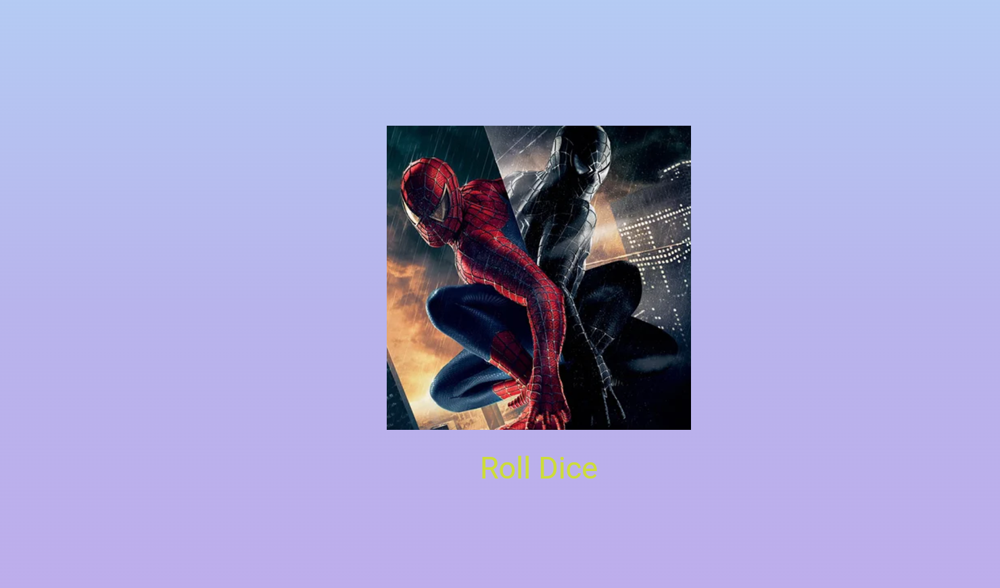

# Лабораторная работа №4-5. Flutter: структура UI и компонентный подход

**Выполнила:** Буничева Алёна
**Группа:** ИСП-242
**Дата сдачи:** 14.10.2026

---

## Что было изучено
1. Научилась разбивать интерфейс на отдельные классы-виджеты для улучшения читаемости кода.
2. Освоила практику выноса компонентов в отдельные файлы внутри папки `lib/` с использованием соглашения `snake_case` и импортом пакетов.
3. Научилась делать виджеты гибкими, передавая в них переменные через конструкторы с использованием ключевого слова `final`.
4. Подключение и настройка отображения изображений игральных костей через файл `pubspec.yaml`.
5. Реализация динамического обновления UI.

## Скриншот финального приложения


---

## Ссылка на репозиторий
[Ссылка на GitHub репозиторий](https://github.com/youkani/Flutter_Lab4.git)

## Инструкция по запуску
1. Клонировать репозиторий:
   ```bash
   git clone https://github.com/youkani/Flutter_Lab4.git
   ```
2. Перейти в папку проекта:
   ```bash
   cd Flutter_Lab4
   ```
3. Установить зависимости:
   ```bash
   flutter pub get
   ```
4. Запустить приложение:
   ```bash
   flutter run
   ```

## Ответы на вопросы

### 1. Зачем выносить виджеты в отдельные файлы? Что изменится, если держать всё в main.dart?
Вынос виджетов в отдельные файлы необходим для улучшения читаемости кода, возможности переиспользования и упрощения командной разработки. Если держать всё в `main.dart` найти нужный фрагмент кода становится сложнее и нарушается принцип единственной ответственности.

### 2. Что такое BuildContext? Почему метод build() принимает его как параметр?
`BuildContext` это адрес виджета, который показывает, где именно он находится в общем дереве элементов. Через него виджет понимает свое окружение. Например, с помощью `context` он может узнать тему оформления приложения, размеры экрана или открыть новый экран.

### 3. Чем StatelessWidget отличается от StatefulWidget? Приведите пример, когда нужен каждый из них.
`StatelessWidget` это статичный виджет. Он создается один раз и сам по себе на экране измениться не может. Например обычный текст, иконка или фоновый градиент.
`StatefulWidget` это динамичный виджет. Он умеет меняться на ходу с помощью команды `setState()`. Например кнопка-переключатель или поле для ввода текста.

### 4. Почему Random() создаётся на уровне файла, а не внутри rollDice()?
Если создавать `Random()` внутри функции, то при каждом клике на кнопку телефон будет тратить память и время на создание нового генератора случайных чисел. Вынос на уровень файла создает генератор один раз, а при кликах просто берем из него новые случайные числа.

